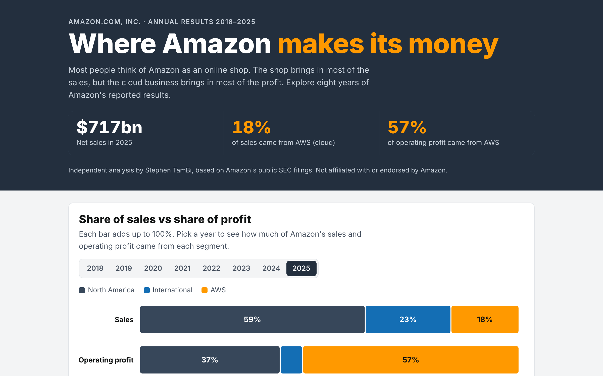

# Where Amazon Makes Its Money

By **Stephen TamBi** · [Website](https://stambi292.github.io) · [LinkedIn](https://www.linkedin.com/in/stephen-tambi-1b4326317/)

An interactive analysis of Amazon's reported results from 2018 to 2025: which parts of the business bring in the sales, which bring in the profit, and what happens to profit when margins change.

**[Open the interactive page](https://stambi292.github.io/amazon-analysis/)**



## Business questions
1. Where does Amazon's revenue come from, and where does its profit come from?
2. How much profit does each segment keep per $100 of sales?
3. Which revenue streams are growing fastest?
4. How big is Amazon in Europe?
5. How sensitive is total profit to each segment's margin?

## Key findings
- In 2025, **AWS (cloud) made 18% of sales but 57% of operating profit**.
- AWS keeps about **$35 of every $100** it sells; North America about $7.
- **Advertising grew 3.5x since 2020**, from $19.8bn to $68.6bn, the fastest of any revenue stream.
- **Germany is Amazon's second-largest country** by sales after the US ($45.9bn in 2025).
- One percentage point of margin in North America is worth about **$4.3bn a year**, more than in AWS, because North America sells far more.

## Data
`data/amazon_data.json` was built by hand from Amazon's Form 10-K annual reports and fourth-quarter results releases (SEC EDGAR). Every year was checked: segments, revenue streams and countries all add up to Amazon's reported totals.

## How it's built
- `scripts/check_data.py` checks the dataset: totals and breakdowns must match the reported figures.
- `scripts/build_page.py` inserts the data into `src/template.html` and writes `index.html`.
- The page itself is plain HTML, inline SVG charts and JavaScript, with no libraries.

```
python scripts/check_data.py
python scripts/build_page.py
```

## Sources
- Amazon.com, Inc. Form 10-K, fiscal years 2020, 2022 and 2025 (segment and product tables)
- Amazon.com, Inc. fourth-quarter results releases, 2022, 2024 and 2025

*Independent analysis based on public filings. Not affiliated with or endorsed by Amazon.*
