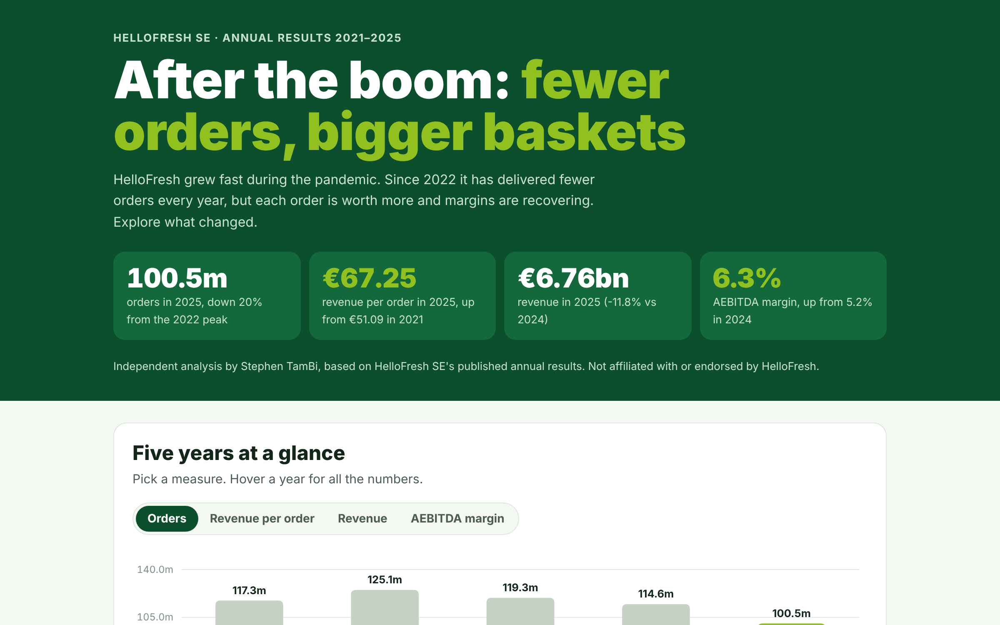

# HelloFresh: After the Boom

An interactive analysis of HelloFresh SE's results from 2021 to 2025: fewer orders, bigger baskets, and whether efficiency or volume matters more for profit.

**[Open the interactive page](https://stambi292.github.io/hellofresh-analysis/)**



## Business questions
1. How have orders, revenue per order and margins changed since the pandemic boom?
2. How do North America and International compare?
3. Are meal kits or ready-to-eat meals more profitable?
4. Is HelloFresh better off winning back orders or improving margins?

## Key findings
- Orders peaked at **125.1m in 2022** and fell to **100.5m in 2025** (−20%).
- **Revenue per order rose 32%**, from €51.09 (2021) to €67.25 (2025), keeping revenue near €7.6bn until 2024.
- North America is 62% of revenue but **lost 16% of its revenue in 2025**; International held almost flat.
- **Meal kits reached a 13.5% margin** while ready-to-eat slipped to −1.2%.
- One extra point of margin is worth about **€68m**, roughly the same as **16% more orders**.

## Data
`data/hellofresh_data.json` was built from HelloFresh SE's annual results releases. Regions were checked to add up to group totals, and margins to match profit divided by revenue.

## How it's built
- `scripts/check_data.py` checks the dataset: totals and breakdowns must match the reported figures.
- `scripts/build_page.py` inserts the data into `src/template.html` and writes `index.html`.
- The page itself is plain HTML, inline SVG charts and JavaScript, with no libraries.

```
python scripts/check_data.py
python scripts/build_page.py
```

## Sources
- HelloFresh SE annual results releases for FY 2022, 2023, 2024 and 2025

*Independent analysis based on public results. Not affiliated with or endorsed by HelloFresh.*
