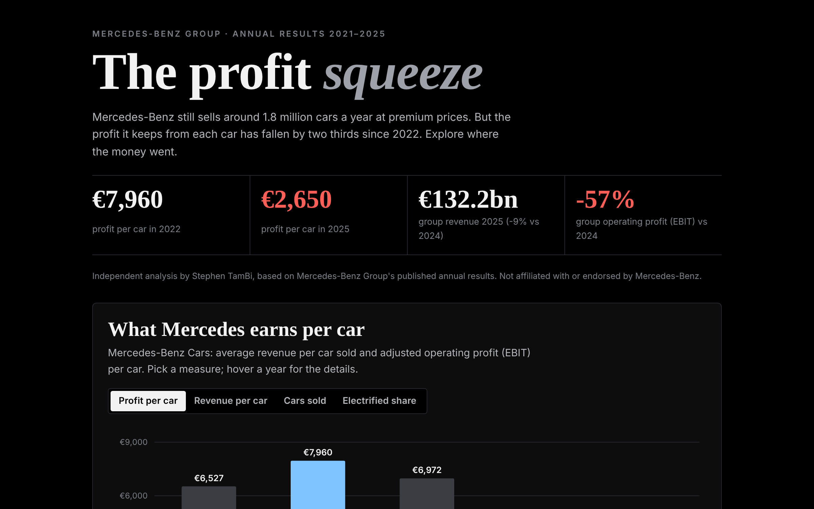

# Mercedes-Benz: The Profit Squeeze

An interactive analysis of Mercedes-Benz Group's results from 2021 to 2025: why profit per car fell by two thirds while prices held up, and what it would take to bring margins back.

**[Open the interactive page](https://stambi292.github.io/mercedes-benz-analysis/)**

## Business questions
1. How much does Mercedes earn per car, and how has that changed?
2. How do car and van margins compare?
3. Where were the cars sold in 2025, and where did sales fall?
4. How is the financing business (Mercedes-Benz's own bank) doing?
5. What combination of volume, price and cost would restore a 10% margin?

## Key findings
- **Profit per car fell from €7,960 (2022) to €2,650 (2025)**, a drop of 67%.
- **Revenue per car barely moved** (−2%): prices held up, but cost per car rose about 9% and fewer cars were sold.
- Car margin dropped from **14.6% to 5.0%**; vans held up better at 10.2%.
- **China fell 19% in 2025** and is the largest single market.
- Each 1% on price is worth about **€1.0bn a year**; a 10% margin would need about **5.3% lower cost per car**.

## Data
`data/mercedes_data.json` was built from Mercedes-Benz Group's annual results releases and its 2025 sales release. Margins were cross-checked against reported profit and revenue. 2025 figures were published as preliminary.

## How it's built
A single HTML page with inline SVG charts and plain JavaScript, no libraries. `src/template.html` is the page before the data is inserted.

## Sources
- Mercedes-Benz Group annual results releases for 2022, 2023 and 2025
- Mercedes-Benz Group sales release, full year 2025

*Independent analysis based on public results. Not affiliated with or endorsed by Mercedes-Benz. No internal company information was used.*
