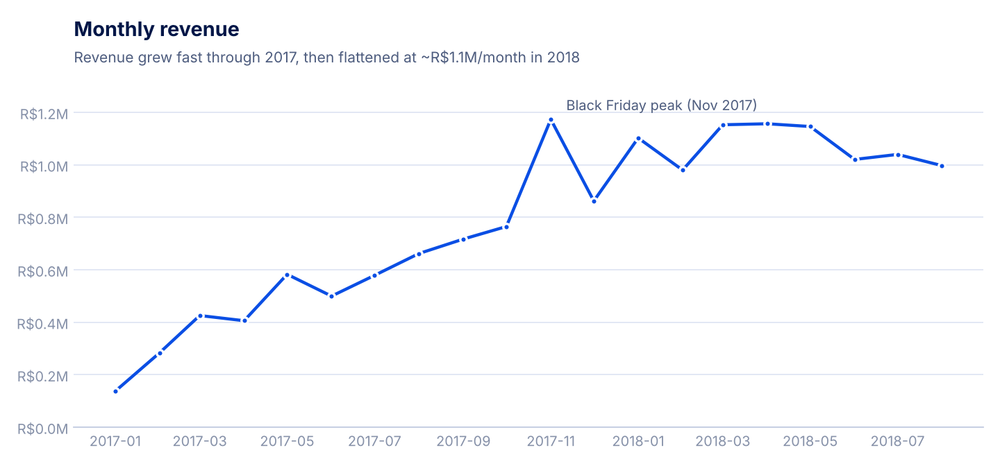
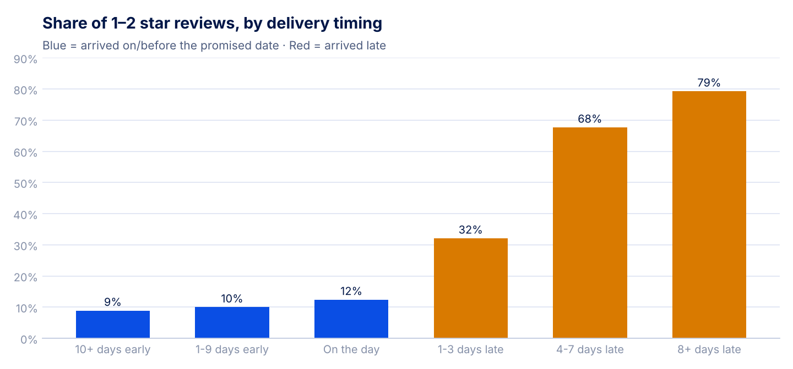
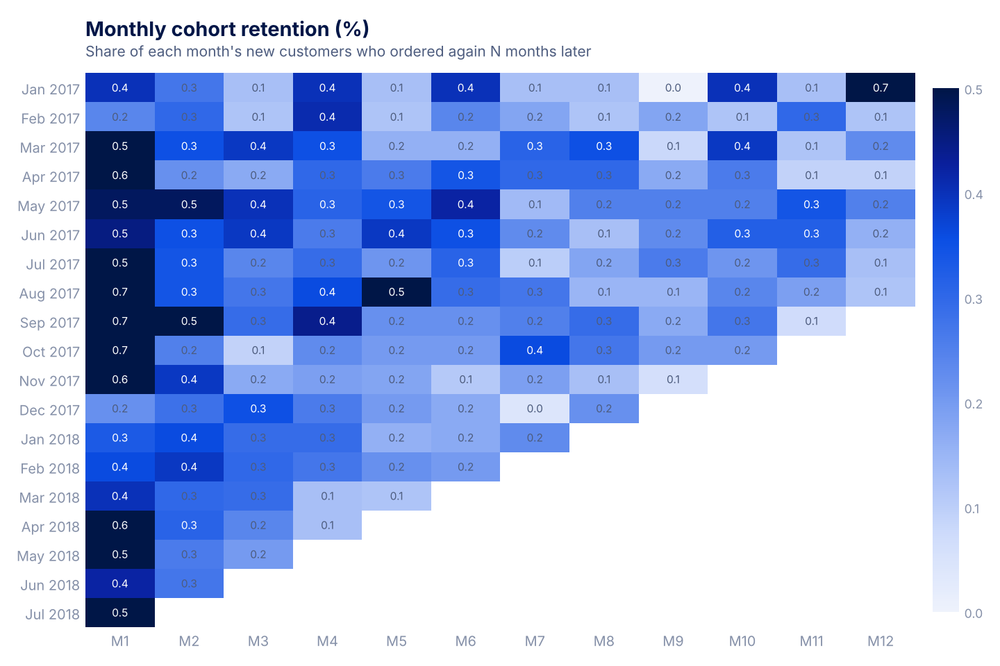
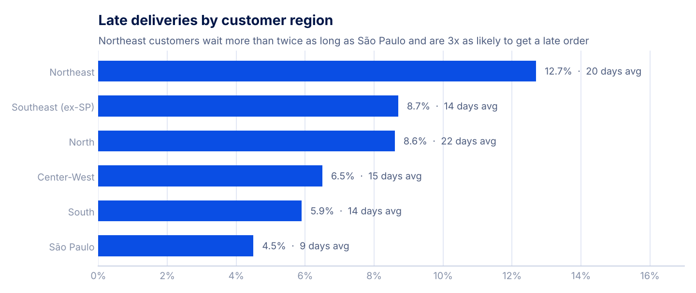
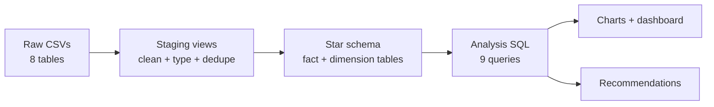
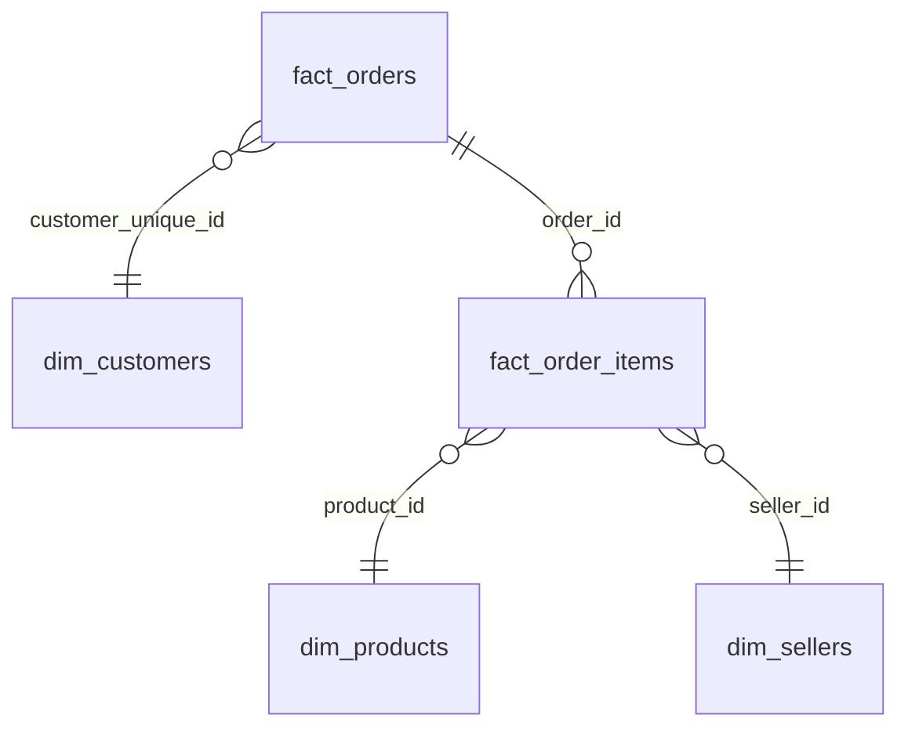

# Olist E-commerce Analytics

By **Stephen tAMBI** · [Website](https://stambi292.github.io) · [LinkedIn](https://www.linkedin.com/in/stephen-tambi-1b4326317/)

End-to-end analytics project on ~100,000 real orders from **Olist**, a Brazilian online marketplace (2016–2018). Raw CSVs are modeled into a tested **star schema with dbt + DuckDB**, analyzed with **SQL and Python**, presented in an **interactive dashboard**, and summarized as **business recommendations**.

**[Open the live dashboard](https://stambi292.github.io/olist-analytics/dashboard/)**

**Business question:** Olist's revenue grew fast in 2017 and then stalled. What is holding growth back, and what should the business do about it?

| | |
|---|---|
| **Dashboard** | [`dashboard/index.html`](dashboard/index.html): interactive, filter by region, product category and date range (open in a browser, or publish with GitHub Pages) |
| **Recommendations** | [`docs/recommendations.md`](docs/recommendations.md) (one page) |
| **Tools** | SQL, dbt, DuckDB, Python (pandas, matplotlib), HTML/JS |

---

## Key findings

**1. Revenue flattened in 2018.** Revenue grew 140% year over year, but monthly revenue has stayed around R$1.0–1.15M since January 2018.



**2. Late deliveries drive bad reviews.** Orders that arrive on time get a 1–2 star review 9–12% of the time. Orders 8+ days late get one 79% of the time. Late orders are 6.8% of deliveries but 32% of all bad reviews.



**3. Almost nobody buys twice.** Only 3.0% of customers ever place a second order. Every monthly cohort retains under 1% in any later month. Customers whose first order was late return about 25% less often.



**4. Distance from São Paulo hurts.** Northeast customers wait 20 days on average (vs. 9 in São Paulo), get almost 3x as many late orders, and pay a higher share of the order value in freight.



**5. Orders split across sellers review badly.** 47% of multi-seller orders get 1–2 stars, against 13% for single-seller orders.

See [`docs/recommendations.md`](docs/recommendations.md) for the five recommended actions.

---

## Data pipeline



### Data model



| Table | Grain | What it holds |
|---|---|---|
| `fact_orders` | one row per order | revenue, freight, payment, review score, delivery days, days late, customer's order number |
| `fact_order_items` | one row per order item | price, freight, product category, seller |
| `dim_customers` | one row per real customer | location, first/last order, cohort month, total orders, lifetime revenue |
| `dim_products` | one row per product | English category, size, units sold, revenue |
| `dim_sellers` | one row per seller | location, orders, revenue |

### Modeling decisions

- **Real customers, not order IDs.** In the raw data `customer_id` changes with every order. The real person is `customer_unique_id`. Using the wrong one would make the repeat rate look like 0%.
- **One review per order.** Some orders have several reviews; staging keeps the most recent one.
- **Valid orders only.** Canceled and unavailable orders are excluded from revenue and customer metrics.
- **Revenue = item price + freight.** A dbt test checks this matches the amount actually paid for 99%+ of orders.
- **Partial months excluded.** 2016 and September–October 2018 have very few orders, so trend charts cover Jan 2017 – Aug 2018.

### Data quality tests

49 dbt tests run on every build: unique and not-null keys, relationships between every fact and dimension, accepted values for order status and review score, plus two custom tests (payments match order value; no delivery before purchase).

---

## How to run it

Requires Python 3.10+.

```bash
pip install -r requirements.txt
./scripts/download_data.sh        # downloads the public Olist CSVs into data/raw
dbt build --profiles-dir .        # builds all models and runs the 49 tests -> olist.duckdb
python analysis/run_analysis.py   # runs the queries, saves CSVs, draws charts, builds the dashboard
```

Then open `dashboard/index.html` in a browser.

**Power BI version:** see [`powerbi/GUIDE.md`](powerbi/GUIDE.md) for the data model, DAX measures and an Olist colour theme.

**Using Power BI or Tableau instead:** query results are saved as CSVs in `analysis/output/`, which either tool can import directly. To export a full table, run for example `duckdb olist.duckdb "COPY marts.fact_orders TO 'fact_orders.csv' (HEADER)"`.

## Project structure

```
├── models/
│   ├── staging/          # 7 staging views: cleaning, typing, dedupe + tests
│   └── marts/            # star schema: 2 fact + 3 dimension tables + tests
├── tests/                # custom data tests
├── macros/               # schema naming + reusable unique-combination test
├── analysis/
│   ├── queries/          # 10 SQL files: 9 analysis questions + the dashboard's filter data
│   ├── output/           # query results as CSV
│   └── run_analysis.py   # runs queries, draws charts, builds dashboard
├── dashboard/            # interactive HTML dashboard (template + built page)
├── powerbi/              # Power BI build guide, DAX measures and Olist theme
├── docs/
│   ├── recommendations.md
│   └── images/           # charts used in this README
└── scripts/download_data.sh
```

## Data source

[Olist public e-commerce dataset](https://github.com/olist/work-at-olist-data) (also on [Kaggle](https://www.kaggle.com/datasets/olistbr/brazilian-ecommerce)): 99,441 anonymized orders placed between 2016 and 2018.
